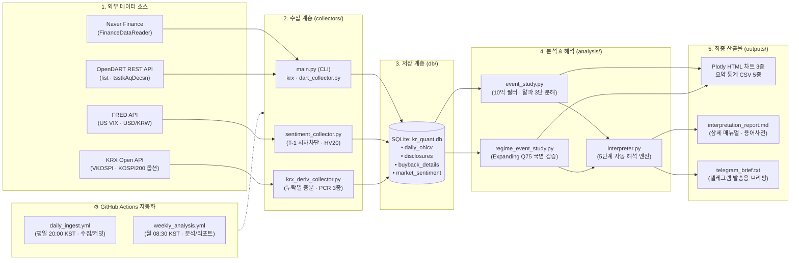

# 📈 KR Quant Pipeline: KOSPI 200 Event-Driven & Derivatives Sentiment Automation

> **코스피200 종목 주가 · OpenDART 공시 · 글로벌/국내 파생 심리지표(VIX · VKOSPI · 옵션 PCR)를 무인 수집·적재하고, 편향을 제거한 통계 검증과 5단계 자동 해석 리포트까지 생성하는 End-to-End 퀀트 파이프라인**


---

## 1. 프로젝트 배경 및 핵심 목표

단발성 백테스트 스크립트를 넘어, **실제 운용 가능한 수준의 데이터 엔지니어링과 계량 검증 자동화 시스템**을 구축하는 것을 목표로 했습니다.

1. **End-to-End 무인 자동화:** 데이터 성격에 따라 수집 주기를 이원화(일간 증분 수집 + 주간 보정·분석·리포팅)하여 GitHub Actions에서 무인 운영합니다.
2. **학술 가설의 실증 검증:** 파생상품 투자심리 논문(*Whaley 2000; Bandopadhyaya & Jones 2008; Han, Kutan & Ryu 2015; Song, Ryu & Webb 2016*)을 기반으로, **시장 공포 국면에서 공시 이벤트의 가격 발견이 지연(Underreaction/Drift)되는지** 5년 치 코스피200 데이터로 검증했습니다.
3. **현업 수준의 편향 통제:** 미래참조 편향(Look-ahead Bias), 저유동성 왜곡, 거래정지일, 시가 갭 착시, 다중검정 편향을 코드 레벨에서 차단했습니다.

---

## 2. 시스템 아키텍처 (End-to-End Flow)



### 이원화 자동화 스케줄 (GitHub Actions)
| 워크플로우 | 실행 주기 (KST) | 수행 작업 | 자동 커밋 대상 |
| :--- | :--- | :--- | :--- |
| **`daily_ingest.yml`** | 평일(월~금) 20:00 | 최근 5일 주가·공시 + 전체 심리지표 + KRX 파생 누락일 증분 적재 | `kr_quant.db` |
| **`weekly_analysis.yml`** | 매주 월요일 08:30 | 최근 10일 보정 수집 → 이벤트 스터디 → 국면 분석 → 5단계 자동 해석 리포트 생성 | `kr_quant.db`, `outputs/` |

---

## 3. 5년 치 실증 검증 핵심 결과 (2022.02 ~ 2026.11)

> **검증 조건:** 코스피200 구성종목 · 직전 5일 평균 일거래대금 **10억 원 미만 제외**(유효 표본 `n=11,276`) · 진입/청산 **`D+1 시가 → D+5 종가`** 시장중립 초과수익률 · 왕복 거래비용 **`0.25%` 차감** · 국면 분류 **`Expanding Q75`**(Look-ahead Bias 차단)

### ① 전 기간 알파 분해: EMH 선반영 vs 구조적 Sell the News
| 공시 유형 | 건수 | 사후 CAR(%) | 오버나잇 갭(%) | 시장중립 비용후(%) | t-stat | p-value | 승률(%) | 실전 진단 |
| :--- | :---: | :---: | :---: | :---: | :---: | :---: | :---: | :--- |
| **소각** | 411 | +0.91 | **+0.71** | -0.05 | -0.15 | 0.8777 | 43.5 | **EMH 시가 선반영** (CAR의 78%가 시가 갭에 흡수) |
| **영업(잠정)실적** | 3,702 | -0.38 | +0.20 | **-0.84** | **-7.70** | **<0.0001** | 39.9 | **강력한 Sell the News** (회피 필터 적용) |
| **배당** | 1,889 | -0.28 | +0.11 | **-0.66** | **-5.29** | **<0.0001** | 40.9 | **구조적 재료 소멸** (회피 필터 적용) |
| **매출액또는손익구조** | 1,192 | -0.45 | +0.15 | **-0.87** | **-4.86** | **<0.0001** | 39.9 | 롱온리(+0.47%) 대비 부호 반전(**베타 착시** 제거) |

### ② 3대 파생 심리지표(VIX · VKOSPI · 옵션 PCR) 공포 국면 교차 검증
| 공시 유형 | 파생 심리지표 | 평온 국면(%) | 공포 국면(%) | 공포 승률(%) | 공포 건수 | 차이 p-value | 핵심 인사이트 |
| :--- | :--- | :---: | :---: | :---: | :---: | :---: | :--- |
| **자사주_처분/해지** | **미국 VIX** | +0.02 | **-1.70** | **33.6** | 125 | **0.0012\*\*\*** | **본페로니 다중검정(0.0031) 통과** — 공포장 최상위 회피 필터 |
| **자사주_취득/신탁** | **옵션 PCR (거래대금)** | -0.35 | **+1.45** | **61.5** | 96 | **0.0180\*\*** | 국내 실질 풋 헤지 과열 구간의 **역발상 반등 알파** 포착 |
| **고강도 자사주 (≥3배)** | **미국 VIX** | -0.16 | **+2.82** | **75.0** | 12 | **0.0094\*\*\*** | 대형 유동성 종목 중심의 **기회형(Opportunistic) 알파 슬리브** |
| **고강도 자사주 (≥3배)** | **옵션 PCR (거래대금)** | +0.08 | **+2.08** | **88.9** | 9 | 0.5278 | 9전 8승 고승률이나 1건 대형 손실(**좌측 꼬리 이상치**)로 분산 확대 |

* **파생 지표 간 상호보완성 실증 (*Bandopadhyaya & Jones 2008*):**
  * **미국 VIX**는 글로벌 거시 패닉을 반영해 위기 국면의 **악재 하락 증폭(`자사주 처분`)**과 **초대형 방어 매입(`고강도 자사주`)**을 가장 정교하게 분리했습니다.
  * **한국 옵션 PCR(거래대금)**은 저가 외가격(OTM) 거래량 노이즈를 제거한 국내 실질 헤지 수급을 반영해, VIX에서 잡히지 않았던 **일반 `자사주_취득/신탁` 전체(`n=96`)의 유의미한 반등 알파**를 포착했습니다.

### ③ 실전 스트레스 테스트 (`KODEX 200` 헤지 · 다중 보유 시계 · `VKOSPI Rolling`)
초기 동일가중 벤치마크에서 발견된 시그널을 실전 헤지 수단인 **시가총액가중 `KODEX 200(069500)` ETF**와 **다중 보유 시계(`D+3 ~ D+20`)**로 재검증해 벤치마크 착시를 제거하고 시그널별 최적 시계를 확정했습니다. (`analysis/research_deep_dive.py`)

| 시그널 | 건수 | KODEX 200 D+3 | KODEX 200 D+5 | KODEX 200 D+10 | KODEX 200 D+20 | 스트레스 테스트 판정 |
| :--- | :---: | :---: | :---: | :---: | :---: | :--- |
| **VIX 공포 + 고강도 자사주(≥3배)** | 12 | +2.09%\*\* | +2.23%\*\* | +3.98%\*\* | **+7.35%\*\*\*** | **실전 생존 · 20영업일 보유 최적** (Post-Buyback Drift) |
| **VIX 공포 + 자사주 처분/해지** | 125 | -1.22%\*\*\* | **-1.71%\*\*\*** | -1.59%\*\* | -1.31% | **실전 생존 · 5영업일 강력 회피 최적** |
| **영업(잠정)실적 / 배당** | 3,604 / 1,800 | -0.79% / -0.75% | -0.83% / -0.85% | -1.16% / -1.60% | **-1.74% / -2.19%\*\*\*** | **실전 생존 · 5~20영업일 중기 회피** |
| **PCR 공포 + 자사주 취득/신탁** | 96 | +1.46% | +0.93% (p=0.32) | +0.07% | -0.74% | **벤치마크 착시 판정** — 실전 경보 제외 (모니터링 하향) |

* **VKOSPI 체제 변화 재검증:** `Rolling 252일 Q75`로 교체해도 공포 비중(`43.7%`)과 통계적 비유의성($p > 0.15$)이 유지되어, 실전 메인 국면 필터는 **미국 VIX**로 확정하고 VKOSPI·옵션 PCR은 보조 모니터링 지표로 운용합니다.
---

## 4. 퀀트 리서치 엄밀성 & 5단계 자동 해석 엔진

`analysis/interpreter.py`는 단순 수치 출력을 넘어, 아래 **5단계 규칙 엔진**으로 결과를 자동 진단하고 `outputs/interpretation_report.md`(상세 매뉴얼·용어사전 포함)와 `outputs/telegram_brief.txt`(모바일 요약)를 생성합니다.

1. **수익률 순도 분해:** `롱온리` vs `시장중립`, `사후 CAR` vs `오버나잇 갭`, `비용전` vs `비용후`를 교차 비교해 시장 베타 착시와 EMH 선반영을 자동 태깅.
2. **통계·분포 건전성:** $t$-검정, 본페로니 다중검정 교정($0.05/K$), 평균-승률 방향 일치성, 그리고 **고승률·저 $t$-stat 이상치 왜곡**을 자동 경고.
3. **국면 상호작용 검증:** `Expanding Q75`로 Look-ahead Bias를 제거하고, 호재·악재 대칭성과 변동성 체제 변화(Regime Shift) 비중을 자동 점검.
4. **편향·유동성 통제:** 거래정지일(`volume == 0`) 제외, 직전 5일 평균 일거래대금 10억 원 미만 필터링, 미국 VIX `T-1`일 이하 후방 결합(`merge_asof`).
5. **실전 운용 번역:** 한국 시장의 공매도 제약을 고려해 음(-)의 알파는 **리스크 회피(Avoidance) 필터**로, 저빈도 고확신 양(+)의 알파는 **기회형 알파 슬리브**로 자동 분류.

> **연구의 구조적 한계 (Caveats):** 최신 코스피200 구성종목 기준 소급에 따른 생존편향(Survivorship Bias), 동일가중 벤치마크와 시총가중 지수(KODEX 200) 간 추적오차, 장중/장후 공시 시각 미구분 한계를 리포트에 명시하고 있습니다.

---

## 5. 데이터 엔지니어링 & 주요 트러블슈팅

| 직면한 문제 | 원인 분석 | 해결 및 아키텍처 개선 |
| :--- | :--- | :--- |
| **KRX 로그인 크롤링 차단** | `pykrx` 대량 조회 시 KRX 서버 세션 차단 및 Python 3.12 호환성 오류 | 로그인 불필요한 **`FinanceDataReader`**로 전면 교체 (수집 속도 3배 향상, 클라우드 안정성 확보) |
| **OpenDART 래퍼 오류 & 3개월 제한** | `OpenDartReader` 의존성 충돌 및 API 1회 최대 90일 조회 제한 | `requests` 기반 **공식 REST API 직접 호출 + 페이지네이션 + 89일 자동 분할(Chunking)** 구현 |
| **수집 모듈 간 장애 전파** | 주가 API 오류 시 공시 수집(`--mode dart`)까지 중단되는 결합도 문제 | `main.py` **지연 로딩(Lazy Import)** 도입 및 DB 저장 종목 리스트 재사용으로 장애 격리 |
| **SQLite Upsert 컬럼 덮어쓰기** | `INSERT OR REPLACE` 사용 시 타 수집기가 채운 `vkospi`/`pcr` 컬럼이 `NULL`로 초기화 | **`ON CONFLICT(date) DO UPDATE SET`** 구문으로 교체해 다중 수집기 간 컬럼 독립성 보장 |
| **미래참조 편향 & 저유동성 왜곡** | 전체 기간 고정 VIX 분위수 사용 및 소형주 거래대금 분모 왜곡 | **`Expanding Q75`** 적용 및 전 스크립트 **일거래대금 10억 원 필터** 통일 |

---

## 6. 프로젝트 폴더 구조

```text
kr_quant_pipeline/
├── .github/workflows/
│   ├── daily_ingest.yml            # 평일 20:00(KST) 일간 증분 데이터 수집 자동화
│   └── weekly_analysis.yml         # 매주 월 08:30(KST) 전체 분석 & 리포트 자동화
├── collectors/
│   ├── krx_collector.py            # FinanceDataReader 기반 코스피200 수정주가 수집
│   ├── dart_collector.py           # OpenDART REST API(89일 분할) 공시 & 자사주 상세 수집
│   ├── sentiment_collector.py      # FRED(VIX, 환율, T-1 결합) & 국내 HV20 산출
│   └── krx_deriv_collector.py      # KRX Open API 기반 VKOSPI & 옵션 PCR 3종 증분 수집
├── db/
│   └── database.py                 # SQLite 절대경로 연결, 스키마 초기화, Upsert 관리
├── analysis/
│   ├── event_study.py              # 공시 세분화, 유동성 필터, 알파 3단 분해 & Plotly 차트
│   ├── regime_event_study.py       # 3대 파생지표 Expanding Q75 국면별 통계 검증
│   └── interpreter.py              # 5단계 자동 해석 엔진 (상세 MD 리포트 & 텔레그램 브리핑)
├── outputs/                        # 최신 CSV, 인터랙티브 HTML 차트, 자동 해석 리포트
├── main.py                         # 통합 CLI 진입점 (--mode stock|dart|all --days N)
├── kr_quant.db                     # 5년 치 통합 SQLite 데이터베이스
└── requirements.txt                # 의존성 패키지 목록
```

---

## 7. 빠른 실행 가이드 (Quick Start)

### 1) 환경 설정
```bash
git clone [https://github.com/smy4462-hash/kr_quant_pipeline.git](https://github.com/smy4462-hash/kr_quant_pipeline.git)
cd kr_quant_pipeline
pip install -r requirements.txt
```

프로젝트 루트에 `.env` 파일을 생성하고 무료 발급받은 API 키를 입력합니다.
```env
DART_API_KEY="YOUR_OPENDART_API_KEY"
KRX_API_KEY="YOUR_KRX_OPEN_API_KEY"
```

### 2) 데이터 수집 & 분석 실행
```bash
# 1. 주가 · 공시 · 자사주 상세 수집 (예: 최근 30일)
python main.py --mode all --days 30

# 2. 매크로 심리지표(VIX, 환율, HV20) 및 KRX 파생지표(VKOSPI, 옵션 PCR) 수집
python collectors/sentiment_collector.py --days 2000
python collectors/krx_deriv_collector.py

# 3. 이벤트 스터디 · 국면 검증 · 5단계 자동 해석 리포트 생성
python analysis/event_study.py
python analysis/regime_event_study.py
python analysis/interpreter.py
```

---

## 8. 향후 고도화 로드맵 (v2 Scale-Up)

- [x] **텔레그램 주간 리포트 & 일간 실시간 경보 봇 연동** (`notifiers/telegram_bot.py`, `daily_alert.py`)
- [x] **KODEX 200 시총가중 벤치마크 · 다중 보유 시계(`D+3~D+20`) · VKOSPI Rolling 스트레스 테스트 완료** (`analysis/research_deep_dive.py`)
- [ ] **v2 저장소 스케일업:** 국내 상장 전 종목 및 미국 시장 확장을 위한 `DuckDB + Parquet` + `Supabase` 하이브리드 아키텍처 전환
- [ ] **포트폴리오 자본 배분 백테스터:** CAGR · Sharpe Ratio · MDD 산출 및 회피 필터 전후 성과 비교