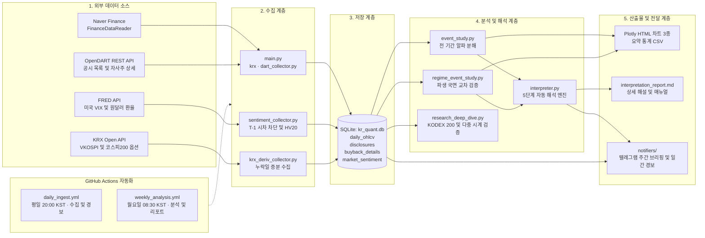

# KR Quant Pipeline

코스피200 종목의 주가, OpenDART 공시, 글로벌 및 국내 파생 심리지표를 무인 수집하고, 통계적 편향을 통제한 검증과 5단계 자동 해석 리포트, 텔레그램 실시간 알림까지 수행하는 End-to-End 퀀트 데이터 파이프라인입니다.


---

## 핵심 요약

본 프로젝트는 단발성 백테스트 스크립트를 넘어, 실제 운용 가능한 수준의 데이터 엔지니어링과 계량 검증 자동화 시스템을 구축하는 것을 목표로 합니다.

* **무인 자동화 운영:** GitHub Actions를 통해 평일 장 마감 후 일간 증분 수집과 실시간 경보를, 매주 월요일 아침 주간 전체 분석과 텔레그램 브리핑을 자동 실행합니다.
* **실증 검증 및 착시 제거:** 5년 치 코스피200 데이터를 대상으로 시가총액가중 벤치마크인 KODEX 200 헤지와 다중 보유 시계 스트레스 테스트를 수행하여, 실제 생존하는 알파와 벤치마크 착시를 구분했습니다.
* **엄격한 편향 통제:** 미래참조 편향 차단, 일평균 거래대금 10억 원 미만 저유동성 종목 제외, 거래정지일 제외, 왕복 거래비용 0.25% 차감을 전 파이프라인에 일관 적용합니다.

---

## 1. 시스템 아키텍처



### 자동화 실행 스케줄

| 워크플로우 | 실행 주기 | 수행 작업 | 자동 반영 대상 |
| :--- | :--- | :--- | :--- |
| `daily_ingest.yml` | 평일 20:00 KST | 최근 5일 주가 및 공시 수집, 심리지표 갱신, 실시간 시그널 경보 발송 | `kr_quant.db`, 텔레그램 알림 |
| `weekly_analysis.yml` | 매주 월요일 08:30 KST | 최근 10일 보정 수집, 이벤트 스터디 및 국면 검증, 자동 해석 리포트 발송 | `kr_quant.db`, `outputs/`, 텔레그램 알림 |

---

## 2. 5년 치 실증 검증 결과

* **검증 기간 및 대상:** 2022년 2월 ~ 2026년 11월, 코스피200 구성종목 중 직전 5일 평균 일거래대금 10억 원 이상 유효 표본 11,276건
* **수익률 산출 기준:** 익일 시가 진입 후 목표 영업일 종가 청산, 왕복 거래비용 0.25% 차감, 국면 분류는 과거 누적 상위 25% 기준인 Expanding Q75 적용

### 2-1. 전 기간 알파 분해: 시가 선반영과 구조적 재료 소멸

동일가중 코스피200 시장중립 5영업일 기준으로 공시 유형별 수익률 순도를 분해한 결과입니다.

| 공시 유형 | 표본 수 | 사후 누적초과수익률 | 오버나잇 갭 | 시장중립 비용후 | t-통계량 | 유의확률 | 승률 | 실전 진단 |
| :--- | :---: | :---: | :---: | :---: | :---: | :---: | :---: | :--- |
| 자사주 소각 | 411 | +0.91% | +0.71% | -0.05% | -0.15 | 0.8777 | 43.5% | 시가 선반영으로 진입 시 알파 소멸 |
| 영업잠정실적 | 3,702 | -0.38% | +0.20% | -0.84% | -7.70 | 0.0000 | 39.9% | 구조적 재료 소멸, 회피 필터 적용 |
| 배당 | 1,889 | -0.28% | +0.11% | -0.66% | -5.29 | 0.0000 | 40.9% | 구조적 재료 소멸, 회피 필터 적용 |
| 매출액 또는 손익구조 | 1,192 | -0.45% | +0.15% | -0.87% | -4.86 | 0.0000 | 39.9% | 롱온리 양수 대비 부호 반전, 회피 필터 적용 |

### 2-2. 실전 스트레스 테스트: KODEX 200 헤지 및 다중 보유 시계

초기 동일가중 벤치마크에서 포착된 시그널을 실제 헤지 수단인 시가총액가중 `KODEX 200` ETF와 다중 보유 시계로 재검증했습니다. 이 과정에서 벤치마크 착시를 제거하고 시그널별 최적 보유 기간을 확정했습니다.

| 시그널 구분 | 표본 수 | 3영업일 | 5영업일 | 10영업일 | 20영업일 | 스트레스 테스트 최종 판정 |
| :--- | :---: | :---: | :---: | :---: | :---: | :--- |
| 미국 VIX 공포 및 고강도 자사주 3배 이상 | 12 | +2.09% | +2.23% | +3.98% | **+7.35%** | 실전 생존, 20영업일 보유 최적 |
| 미국 VIX 공포 및 자사주 처분 및 해지 | 125 | -1.22% | **-1.71%** | -1.59% | -1.31% | 실전 생존, 5영업일 강력 회피 최적 |
| 영업잠정실적 | 3,604 | -0.79% | -0.83% | -1.16% | **-1.74%** | 실전 생존, 5~20영업일 중기 회피 |
| 배당 | 1,800 | -0.75% | -0.85% | -1.60% | **-2.19%** | 실전 생존, 5~20영업일 중기 회피 |
| 옵션 풋콜비율 공포 및 자사주 취득 및 신탁 | 96 | +1.46% | +0.93% | +0.07% | -0.74% | 벤치마크 착시 판정, 실전 경보 제외 |

* **벤치마크 착시 제거:** 옵션 풋콜비율 공포 구간의 자사주 취득은 동일가중 기준에서 유의미했으나, KODEX 200 헤지 적용 시 5영업일 수익률 +0.93%, 유의확률 0.3156으로 통계적 유의성이 사라졌습니다. 이에 실전 매매 경보에서 제외하고 참고용 모니터링으로 하향했습니다.
* **한국 VKOSPI 체제 변화 재검증:** Expanding Q75와 최근 1년 기준인 Rolling 252일 Q75를 비교했으나, 두 방식 모두 공포 비중이 43% 이상으로 확대되고 전 공시 유형에서 유의확률 0.15를 초과했습니다. 따라서 실전 메인 국면 필터는 **미국 VIX**로 확정하고, VKOSPI와 옵션 풋콜비율은 보조 지표로 운용합니다.

---

## 3. 5단계 자동 해석 엔진

`analysis/interpreter.py`는 단순 수치 출력에 그치지 않고, 아래 5단계 규칙에 따라 검증 결과를 자동 진단하여 상세 리포트와 텔레그램 주간 브리핑을 생성합니다.

1. **수익률 순도 분해:** 롱온리와 시장중립, 사후 누적초과수익률과 오버나잇 갭, 비용 차감 전후를 교차 비교하여 베타 착시와 시가 선반영을 자동 식별합니다.
2. **통계 및 분포 건전성 점검:** t-검정, 본페로니 다중검정 교정, 평균과 승률의 방향 일치성, 고승률 대비 저통계량 이상치 왜곡을 자동 경고합니다.
3. **국면 상호작용 검증:** Expanding Q75를 적용해 미래참조 편향을 차단하고, 공포 국면과 평온 국면 간 격차의 통계적 유의성을 점검합니다.
4. **편향 및 유동성 통제:** 거래정지일과 일평균 거래대금 10억 원 미만 종목을 제외하며, 미국 VIX는 시차를 반영해 전일 이하 값만 후방 결합합니다.
5. **실전 운용 번역:** 국내 공매도 제약을 반영해 음의 알파는 신규 매수 보류 필터로, 저빈도 고확신 양의 알파는 기회형 매수 슬리브로 분류합니다.

---

## 4. 데이터 엔지니어링 및 주요 트러블슈팅

| 직면한 문제 | 원인 분석 | 해결 방안 |
| :--- | :--- | :--- |
| KRX 로그인 크롤링 차단 | 대량 조회 시 세션 차단 및 Python 3.12 호환성 오류 발생 | 로그인 불필요한 FinanceDataReader로 전면 교체하여 수집 속도 3배 향상 |
| OpenDART 래퍼 오류 및 조회 제한 | 외부 래퍼 의존성 충돌 및 API 1회 최대 90일 조회 제한 | 공식 REST API 직접 호출, 페이지네이션, 89일 자동 분할 수집 구현 |
| 수집 모듈 간 장애 전파 | 주가 API 오류 시 공시 수집까지 중단되는 결합도 문제 | 지연 로딩 도입 및 DB 저장 종목 리스트 재사용으로 장애 격리 |
| SQLite Upsert 컬럼 덮어쓰기 | INSERT OR REPLACE 실행 시 타 수집기 컬럼이 NULL로 초기화 | ON CONFLICT DO UPDATE 구문으로 교체해 수집기 간 컬럼 독립성 보장 |
| 미래참조 편향 및 저유동성 왜곡 | 전체 기간 고정 분위수 사용 및 소형주 매입강도 분모 왜곡 | Expanding Q75 적용 및 전 스크립트 일거래대금 10억 원 필터 통일 |

---

## 5. 프로젝트 폴더 구조

```text
kr_quant_pipeline/
├── .github/workflows/
│   ├── daily_ingest.yml            # 평일 20:00 일간 증분 수집 및 실시간 경보
│   └── weekly_analysis.yml         # 월요일 08:30 주간 전체 분석 및 브리핑 발송
├── collectors/
│   ├── krx_collector.py            # 코스피200 수정주가 수집
│   ├── dart_collector.py           # OpenDART 공시 및 자사주 상세 89일 분할 수집
│   ├── sentiment_collector.py      # FRED 미국 VIX, 환율 및 국내 HV20 산출
│   └── krx_deriv_collector.py      # KRX Open API 기반 VKOSPI 및 옵션 풋콜비율 수집
├── db/
│   └── database.py                 # SQLite 연결, 스키마 초기화, Upsert 관리
├── analysis/
│   ├── event_study.py              # 전 기간 알파 분해 및 Plotly 차트 생성
│   ├── regime_event_study.py       # 3대 파생지표 Expanding Q75 국면 검증
│   ├── research_deep_dive.py       # KODEX 200 헤지, 다중 보유 시계, VKOSPI Rolling 검증
│   └── interpreter.py              # 5단계 자동 해석 엔진
├── notifiers/
│   ├── telegram_bot.py             # 텔레그램 메시지 및 리포트 파일 전송 모듈
│   └── daily_alert.py              # 일간 공시 및 파생 국면 실시간 경보 생성기
├── outputs/                        # 최신 CSV, Plotly HTML 차트, 자동 해석 리포트
├── main.py                         # 통합 CLI 진입점
├── kr_quant.db                     # 5년 치 통합 SQLite 데이터베이스
└── requirements.txt                # 의존성 패키지 목록
```

---

## 6. 실행 가이드

### 1단계: 설치 및 환경 변수 설정
```bash
git clone [https://github.com/smy4462-hash/kr_quant_pipeline.git](https://github.com/smy4462-hash/kr_quant_pipeline.git)
cd kr_quant_pipeline
pip install -r requirements.txt
```

프로젝트 루트에 `.env` 파일을 생성하고 발급받은 API 키를 입력합니다.
```env
DART_API_KEY="YOUR_OPENDART_API_KEY"
KRX_API_KEY="YOUR_KRX_OPEN_API_KEY"
TELEGRAM_BOT_TOKEN="YOUR_TELEGRAM_BOT_TOKEN"
TELEGRAM_CHAT_ID="YOUR_TELEGRAM_CHAT_ID"
```

### 2단계: 수집, 분석 및 알림 실행
```bash
# 1. 주가, 공시, 파생 심리지표 수집
python main.py --mode all --days 30
python collectors/sentiment_collector.py --days 2000
python collectors/krx_deriv_collector.py

# 2. 통계 분석 및 자동 해석 리포트 생성
python analysis/event_study.py
python analysis/regime_event_study.py
python analysis/research_deep_dive.py
python analysis/interpreter.py

# 3. 텔레그램 주간 브리핑 및 일간 경보 발송
python notifiers/telegram_bot.py --attach-report
python notifiers/daily_alert.py --days 1
```

---

## 7. 향후 고도화 로드맵

- [x] 텔레그램 주간 리포트 및 일간 실시간 경보 봇 자동화 구축
- [x] KODEX 200 시가총액가중 헤지, 다중 보유 시계, VKOSPI Rolling 스트레스 테스트 완료
- [ ] **v2 저장소 스케일업:** 국내 상장 전 종목 및 미국 시장 확장을 위한 DuckDB, Parquet, Supabase 하이브리드 아키텍처 전환
- [ ] **포트폴리오 자본 배분 백테스터:** 연복리수익률, 샤프지수, 최대낙폭 산출 및 회피 필터 전후 성과 비교